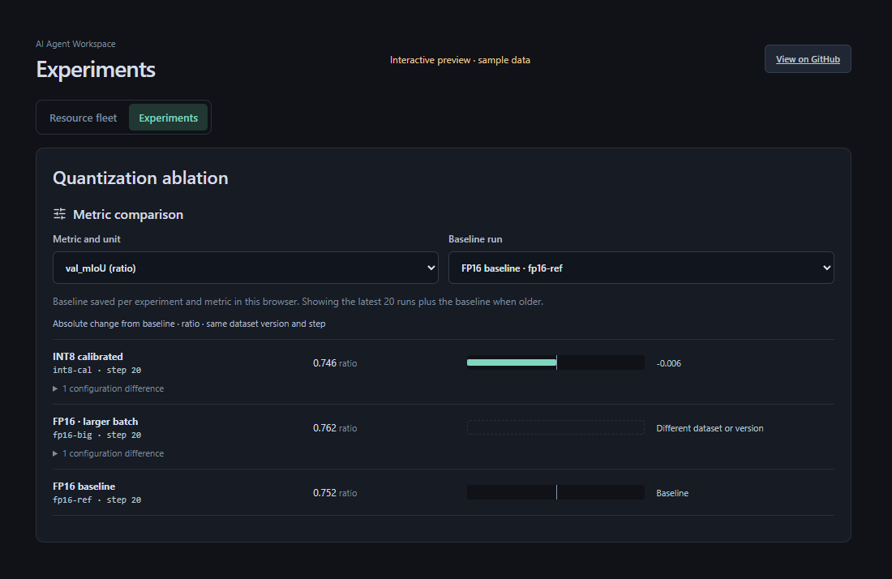

# AI Agent Workspace

Run coding agents in separate Git worktrees, review the commits they produce, and replay local experiment commands against a saved commit. The workspace keeps run history, validation reports and step metrics in SQLite.

在本机调度 Coding Agent，审查它们的改动，也可以绕过 Agent 直接运行自己的实验脚本。每次尝试记录代码提交、命令、配置和指标，方便回看同一个实验是怎么跑出来的。

**Try the sample in your browser.** Switch from `val_mIoU` to `throughput` in the quantization example. The INT8 run and the FP16 baseline share a dataset version. The larger-batch run uses a different version, so you can see exactly why its delta is withheld. [Open the interactive demo](https://vemodalen-x.github.io/ai_workspace/)

[](https://vemodalen-x.github.io/ai_workspace/)

## 快速启动

**Local quick start** requires Node.js 24+, npm and Git 2.38+. Windows 可使用 Git for Windows，SSH 节点需要 OpenSSH 客户端。各平台与 Provider 的验证范围见[测试记录](docs/verification.md)。

```bash
git clone https://github.com/vemodalen-x/ai_workspace.git
cd ai_workspace
npm ci
npm run dev
```

打开 **http://127.0.0.1:5173**。一条开发命令启动 Web 和 Backend；Backend 在 `127.0.0.1:4310`。项目路径是在运行 Backend 的电脑上的路径。

不使用任何付费凭证，也可以运行完整验收：

```bash
# 首次启动服务前执行，创建独立示例仓库；不会修改你的项目
npm run seed
npm run dev
```

进入 Projects → CV-Agent-Project → Queue draft tasks。A、B 并行写入不同的 JSON 产物，C 将其提交合入自己的集成 worktree 并校验。选择 C → Review changes → Preview merge → Review approval → Approve and merge。所有任务明确标记 **Mock Agent**；Mock 不伪装成 Codex / Claude，不制造 Token 或费用数字。

自动化执行同一个 fixture（服务停止时）：

```bash
npm run seed -- --run
```

种子脚本是幂等的，已存在示例项目时不会重复排队。自动化验收会在临时目录创建新仓库，使用 `npm test` 可重复运行。

生产构建和本地服务：

```bash
npm run build
npm start
```

生产模式打开 **http://127.0.0.1:4310**。静态 Web 由同一个 Fastify 进程提供。不要通过公网或 LAN 代理暴露此服务。

Linux 开机启动、退出登录后常驻、进程崩溃与健康检查恢复见 [本机常驻服务](docs/local-service.md)。

项目区支持选择已有本地文件夹、只读查看 Codex / Claude Code 配置与历史，以及仅取消登记的安全移除。目录关联与读取范围见 [项目管理](docs/project-management.md)。

## 挂载已有 Claude Code 会话

在项目页面的 **Attached Claude sessions** 中输入原生 Claude session UUID，点击 **Attach session**。可以挂载从其他工作目录启动的本机会话；页面明确展示原目录，历史和新消息每四秒刷新。来源为 `$CLAUDE_CONFIG_DIR/projects`，默认 `~/.claude/projects`。例如 `ac19a74b-8674-4eb6-903a-34a2ba5c3b0c`。

这是只读挂载，执行仍由原终端负责，不会启动 Agent、消耗模型额度或生成工作台 Run/合并证据。**Detach session** 仅移除关联，不删除源文件。只显示最近有界历史；文件不可用时保留关联并显示错误。当前支持本机 Claude Code，不支持 Codex 或远端历史导入。详见 [API 与读取边界](docs/api-contract.md#attached-external-claude-sessions)。

## v0.8 本地命令实验

1. 导入包含实验脚本的 Git 仓库，在 **Experiments → New trial** 选择项目，填写命令参数数组（例如 `["python","train.py"]`）、实验组、数据版本、seed 和资源预算。
2. **Save trial** 固定当前提交与配置。**Run trial → Queue attempt** 会显示并执行这条命令。每次重试在同一提交的新 worktree 中启动。脚本可从环境变量 `WORKSPACE_EXPERIMENT` 读取 JSON 格式的 seed、参数和数据集信息。
3. 脚本向标准输出逐行写入 `WORKSPACE_METRIC {"name":"loss","unit":"","step":1,"value":0.42}`。实验页按 step 绘图，支持切换执行尝试、比较相同指标与单位、查看日志及退出码。命令失败时已收到的读数仍然保留。

命令在本机以当前用户权限运行，使用本机已安装的解释器和依赖。Agent 和命令共用项目并发及 CPU、RAM 和单卡软预留。每次尝试保留工作目录与产物，日志和指标的存储上限见 [Trial API](docs/api-contract.md#local-command-trials)。

## v0.7 工作流与实验入口重构

**Experiments** 已成为独立入口，支持项目筛选、实验组搜索、指标切换、固定基线及返回对应 Session。每个实验组、每项指标的基线保存在当前浏览器中。新增 Run 不会改变已保存的基线；基线早于最近 20 次运行时额外保留一行。基线不可用时要求明确选择，不自动换成其他 Run。

Project / Session 的位置、所选任务、详情标签、Tree / Graph 和搜索保存在 URL 中，支持刷新、浏览器前进与后退。Compute 筛选、GPU 排序、Focus 筛选和实验选择保存在浏览器本地。实验页使用完整工作区宽度；任务 Inspector 只在项目和 Session 页面展示。

应用入口、Shell、Sidebar、TaskTree、基础组件和导航状态已分开。详细边界见 [v0.7 重构设计](docs/refactoring-v07.md)。

启动仍为 `npm ci` 后 `npm run dev`。离线交互预览通过 `npm run preview:visual` 生成，使用明确标记的示例数据。

## v0.6 资源与实验可视化

从 **Compute nodes** 打开资源视图，按服务器名或 SSH 别名筛选设备。设备卡按照当前可预留的显存降序排列，分别画出已用显存和软预留。点击某卡的 History 跳到该服务器的历史并选中对应 UUID。离线、过期和显存缺失的设备显示 Unavailable。该余量仅用于显存判断，任务启动还需满足 CPU、RAM、依赖与并发条件。

打开独立的 **Experiments** 页面，选择项目内的实验组、指标及单位、基线 Run。图表展示最近 20 次运行，必要时额外保留固定基线，并显示原始值和相对基线的绝对差。首次默认基线取组内最早且有对应指标的运行并保存，后续保留该选择。仅在数据集名称、非空版本、指标名称、单位和 step 相同时显示差值。左侧条表示数值下降，右侧表示数值上升；指标的优劣方向由实验者解释。配置差异可展开查看，完整提交和硬件信息位于 Run details。

离线交互预览使用固定示例数据，独立于工作区数据库。执行 `npm run preview:visual` 后，在浏览器打开 `dist/visual-review.html` 即可试用生产界面的 GPU 卡片、历史图和基线对比。正常使用工作台时由真实遥测和绑定提交的验证报告提供数据。

## v0.5 工程评审与优化

已完成 Run 的结果提交绑定合并预览。中断的合并通过目标分支对账。本地实验验证脚本可上报带单位和 step 的指标，实验记录保存结束时可用的 GPU 摘要。终端和依赖图按需加载。升级前停止服务、备份 .workspace，控制端和 Worker 使用同版构建。详见 [评分、实验接入和验收记录](docs/quality-review-v05.md)。

## v0.4：AI 实验与多服务器、多 GPU 监控

Compute fleet 按节点和 GPU UUID 展示真实可获取的利用率、显存、温度、功耗及计算进程；即使没有任务，SSH Worker 也会被周期探测。在线 / 过期 / 离线、实测值与软预算分开显示。SQLite 有界历史支持重启后回看。任务可声明实验组、数据集版本、seed 和参数，同组 Run 可以对比输入提交、硬件与运行窗口内的共享设备读数。

安装依赖后执行 `npm run check:fleet` 检查本机，或 `npm run check:fleet -- fleet.local.json` 验收多台 SSH 主机；不消耗模型额度。升级请先停止服务并备份 `.workspace`，在控制端和各远端使用同版代码重新构建。详见 [实验使用与硬件验收](docs/experiment-fleet.md)。本版监控多卡；单 Run 仍只预留一张，不提供多机 DDP 训练启动器。

## v0.3：执行证据与架构边界

- Run manifest 固定任务/上下文版本、依赖 Run 与提交、输入 HEAD 和实际 prompt hash。
- 依赖或定义变化后，旧结果保留历史但标记 stale；阻止过期结果合并与下游启动。
- 集成工作区使用不可变依赖结果；依赖变化时通过新 Session 验证。
- 验证命令在候选提交的独立 worktree 执行；改写受跟踪源码会使验证失败。
- Run 状态转换校验；核心生命周期状态和事件同事务提交，提交后才推送。
- UI 展示有效性原因、输入清单和 Re-run in new session。

升级说明与边界见 [reliability-v03.md](docs/reliability-v03.md)。旧数据可读；无 manifest 的结果显示 unknown。新版下游任务需要依赖有 current 证据，因此旧依赖可能需要人工重跑。验证目录不继承未跟踪的依赖安装目录，需显式准备验证环境。升级前停止服务并备份 `.workspace`。

## v0.2：个人开发工作助手

- **Focus inbox**：先看需要恢复、审批、排障、澄清和审查的事项，每条有原因和可执行入口。
- **Quick capture**：一句话捕获为 Mock draft，不启动 Agent；补齐目标和验收条件，再显式授权执行。
- **Project context**：保存项目工作约定。调度启动时生成交接包，包含依赖结果和上次执行状态；在 Artifacts 查看实际发送的 `execution-brief.txt`。
- **Result evidence**：分别显示执行状态、验证命令结果、精确提交对应的批准合并。命令通过不等于全部验收标准通过。
- **七天回顾**：真实执行次数与验证覆盖情况，不估造效率或节省时长。

已有 v0.1 数据可直接读取，新增字段向后兼容。升级前停止服务并备份 `.workspace`；旧 Run 无结果提交时不会自动推断已合并。详细设计与资料来源见 [productivity-upgrade.md](docs/productivity-upgrade.md)。

## 配置真实 Agent

锁定的依赖包含官方 Codex SDK/CLI `0.166.0` 和官方、未经修改的 Claude Code CLI `2.1.316`。安装会下载对应操作系统的原生二进制。版本变更时应再次运行契约测试并核对帮助信息。

### Codex

在应用根目录的个人终端执行：

```bash
npx --no-install codex --version
npx --no-install codex login
npx --no-install codex login status
```

使用原生 Codex 登录流程选择你的 ChatGPT 账户或官方支持的认证方式。应用不读取、导出或代理 OAuth token。Task 选择 Codex 后，启动窗口要求勾选实际 Provider 执行确认；这可能消耗订阅额度或 API 额度。账户资格、限额由 Provider 决定，登录检测不等于模型访问保证。

适配器使用官方 `@openai/codex-sdk` 的 `startThread` / `resumeThread` / `runStreamed`。默认 `workspace-write`、`approvalPolicy: never`、关闭网络，表示 **不自动批准沙箱外权限**，不是跳过沙箱。当前 SDK 适配器不支持 UI 内交互式工具审批；需要提升权限的任务可能失败。App Server 的交互审批列入后续阶段。

### Claude Code

```bash
npx --no-install claude --version
npx --no-install claude auth login
npx --no-install claude auth status
```

通过官方 CLI 使用自己的 Claude 订阅或官方 API 认证方式。平台不抽取订阅凭证，不把订阅 token 转成通用 API key；所有用量直接归属用户的 Provider 账户。后续商业分发需要遵循 Provider 当前条款。

执行协议是官方 `-p --output-format stream-json --verbose --include-partial-messages` 与 `--resume`。当前允许 `Read,Glob,Grep,Edit,Write`，**不默认启用任意 Bash**。需要运行测试时，在任务中配置独立的 Validation command 并明确批准。用户级 Claude 设置可能仍有影响；本应用不是恶意仓库的安全隔离环境。需要完整工具授权回调时应增加 SDK / App Server 适配器。

Settings & providers 显示真实 CLI 版本、安装和登录状态，以及能力 flags。没有登录时不会显示已连接。可用 `CODEX_BIN` / `CLAUDE_BIN` 指定可信的原生可执行文件绝对路径，不支持 shell 字符串。Claude 当前 npm 包的 `bin/claude.exe` 在 Linux 也是原生 ELF 文件；代码已按实际包结构实现。

### 实际验证命令

任务 → Resources & remote execution → Validation command，填 JSON argv：

```json
["node", "--test"]
```

```json
["python", "-m", "pytest", "-q"]
```

Agent 回合结束后先创建候选提交，再在该提交的独立验证 worktree 中执行命令。非零退出码、修改受跟踪源码或改变 HEAD 都会使验证失败，日志与验证 Artifact 保留。`shell:false`，不会拼接 shell 字符串。Windows 上 `.cmd` 不能当作普通 exe 直接执行；推荐使用 Node / Python 的原生执行入口。需要 npm 时可以显式批准 `cmd.exe /d /s /c ...`，但这会按你的授权运行 shell。

Validation command 是用户主动提供并确认的代码执行，继承 Backend 用户权限，不能视为容器隔离。独立验证目录不继承 Session 中未跟踪的 node_modules、venv 或数据；需要在显式批准的验证脚本中准备依赖，或使用已配置的外部环境。平台不会自动执行陌生仓库的安装脚本。

## 概念与行为

| 概念                | 含义                                                      |
| ------------------- | --------------------------------------------------------- |
| Project             | 一个本地 Git 根仓库，具有并发上限；v0.1 每项目一个 repo   |
| Task                | 目标、优先级、父节点、独立 DAG 依赖、Provider、节点、预算 |
| Session             | Provider 会话 ID + 一个独立 branch/worktree               |
| Run                 | Session 的一次回合 / 执行尝试，有独立状态、幂等键与日志   |
| Approval            | 绑定来源 SHA、目标 SHA 和目标分支的合并批准               |
| Resource Allocation | 调度软预留，不等同于系统实际用量或 OS 硬限制              |

同一个 Task 可以先后创建多个 Session；同一个 Session 可以继续多轮，每轮产生一个 Run。每个 Task / Session 同时最多有一个非终态 Run，其他 Task 可以并行。Tree 的父子关系不构成依赖。默认父任务不会自动变成“已集成”。

依赖满足后，**已经排队**的后继任务自动启动；草稿任务不会在没有用户启动意图时执行。失败依赖使后继阻塞。重试是显式的新 Run，不会在未知远程状态下自动重试。

Interrupt 会终止当前回合并标记 paused；Continue 会基于持久化 Provider session ID 开始新回合。不是冻结并继续同一个操作系统进程。Codex SDK 没有暴露可验证的子进程 PID，因此其中断会保守标为 orphaned；确认子进程停止并执行 Reconcile 后再继续。

## Git 安全

- 写入型 Session 一律使用 `agent/<session UUID>` 与独立 worktree。
- 初始 worktree 从导入仓库当时的 **已提交 HEAD** 创建，不复制未提交修改。
- 成功执行会在应用管理的 worktree 内生成快照提交；未提交修改会阻止清理。
- 依赖任务的代码不会神奇地出现在 C 中。勾选 Integration worktree 才会把成功依赖的快照提交合入 C；冲突导致准备失败并保留现场。
- Merge preview 不修改项目工作树。批准绑定 exact SHAs，来源或目标变化会被拒绝。目标有任何未提交修改会阻止合并。
- Cleanup 只移除应用记录、注册且干净的 worktree；保留分支与历史。不执行 `reset --hard`、`clean -fd` 或 `branch -D`。
- 有执行历史的项目使用 Archive；有历史的任务拒绝删除。项目删除只删除无历史记录，永不删除仓库目录。
- 不要在审批操作期间用其他工具同时改动目标 Git 仓库。应用内操作串行化，外部 Git 进程不受应用锁控制。

## 资源与远程执行

CPU/RAM、磁盘、网络指标来自宿主机实际采样；NVIDIA 指标来自 `nvidia-smi`。不可获得的数据为 Unavailable，Mock Token/Cost 也为 Unavailable。Claude `total_cost_usd` 是 Provider 的估算且可能累计整个会话，不能相加当作实际账单。

CPU、RAM、VRAM 均为 **soft scheduling budgets**。GPU 选择会给 Agent 子进程设置 `CUDA_VISIBLE_DEVICES`，它是设备可见性提示，不是安全隔离或显存硬上限。墙钟超时会触发取消。没有 cgroups / Docker / Windows Job Object 硬限额。

SSH Worker 安装、认证、同步与故障恢复见 [docs/remote-worker.md](docs/remote-worker.md)。Worker 有真实 Agent 执行、owned worktree、日志/指标/patch 回传与 Run ID 去重；目前是连接绑定的 SSH transport，不是可靠消息队列。断连后的结果不明确，资源保持隔离，需人工检查。

## 测试

```bash
npm run typecheck
npm run lint
npm test
npm run build
# 上面四步的组合
npm run check
npm run test:production

# 在允许启动浏览器的开发环境
npx playwright install chromium
npm run test:e2e
```

单元/集成测试不需要 API key，不启动真实推理。它们使用真实临时 Git 仓库、SQLite 数据库、子进程和 Worker 协议。Playwright 用例覆盖 UI 导入、任务建立、A/B/C 流程、Diff、批准与刷新。

真实 Provider 测试默认跳过，**仅在你愿意消耗额度时**执行：

```bash
# Linux / macOS
RUN_REAL_PROVIDER_TESTS=codex npm run test:providers
RUN_REAL_PROVIDER_TESTS=claude npm run test:providers
```

```powershell
# Windows PowerShell
$env:RUN_REAL_PROVIDER_TESTS="codex"
npm run test:providers
Remove-Item Env:RUN_REAL_PROVIDER_TESTS
```

历次验证的环境与结果见[测试记录](docs/verification.md)。Linux、Windows 和浏览器的每次运行都可以在 [GitHub Actions](https://github.com/vemodalen-x/ai_workspace/actions/workflows/ci.yml) 查看。

## 数据与恢复

默认状态目录 `.workspace/`，用 `WORKSPACE_DATA_DIR` 改为其他绝对路径。含 `workspace.db`、WAL、worktrees、`server.lock`。备份前停止服务；需同时备份用户源仓库的 `.git`、数据库和 worktree 目录，移动后使用 Git 正式的 worktree repair 流程修复绝对路径。不要只复制 SQLite 就认为包含了代码。

异常退出时 `server.lock` 故意保留。**先检查记录的 PID 和它的子进程确实已经停止**，再删除这个锁文件启动服务。启动后旧 running/starting Run 标记 orphaned，配额 quarantine；UI Reconcile execution 明确确认进程已停后才释放。不会因为 PID 存在就自动 kill，避免 PID 复用误杀。

API token 只在服务器与浏览器内存中，不写入 localStorage。后端限定回环地址，校验 Host/Origin，没有通用远程终端接口。数据库包含代码日志/提示文本，应按私有开发资料保护。已知凭证模式会做最佳努力脱敏，但任意程序输出不能保证完全不含敏感内容。

## 项目结构与文档

```text
apps/web/                 React control center, graph, terminal, forms
apps/server/              Fastify HTTP/WS, authentication, startup lifecycle
apps/worker/              SSH-attached JSONL worker
packages/shared/         Zod inputs, domain types, DAG/tree validation
packages/agent-adapters/  Codex SDK, Claude JSONL, explicit Mock, process control
packages/orchestration/  SQLite store, scheduler, state/recovery, SSH transport
packages/resource-manager/ Real metrics and transactional soft reservations
packages/git-manager/    Worktree, snapshot, preview, guarded merge, cleanup
tests/                   Unit, integration, worker, opt-in real providers, E2E
scripts/                 Cross-platform dev supervisor and acceptance seed
docs/                    Architecture, data model, API, remote setup, limits
```

- [Architecture](docs/architecture.md)
- [Implementation plan](docs/implementation-plan.md)
- [Data model](docs/data-model.md)
- [API contract](docs/api-contract.md)
- [Remote Worker](docs/remote-worker.md)
- [Known limitations](docs/known-limitations.md)
- [Verification](docs/verification.md)
