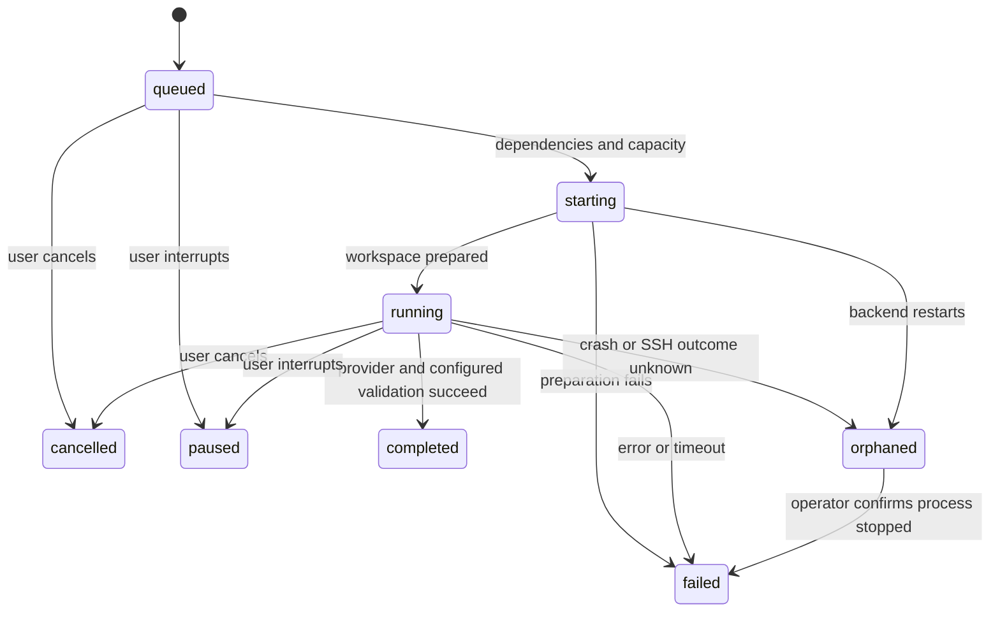

# Data model v1

SQLite WAL via Node 24 `node:sqlite`. UTC ISO timestamps. Entity identifiers are server-generated UUIDs. `schema_version` records schema version 1. Domain records are validated at API/service boundaries and stored as JSON payloads; this is a deliberate v0.1 repository format, not a claim that normalized relational migrations are implemented.

| Table        | Key fields and relationships                                                                                                                                                  |
| ------------ | ----------------------------------------------------------------------------------------------------------------------------------------------------------------------------- |
| projects     | id, name, repoPath (canonical existing Git root), baseBranch, concurrency, archived, createdAt                                                                                |
| tasks        | id, projectId, title, description, criteria, parentId, dependencies[], provider, nodeId, remoteRepoPath, priority, allocation, integration, validationCommand[], state, error |
| sessions     | id, taskId, projectId, provider, nodeId, workspaceId, providerSessionId, model, createdAt, closed                                                                             |
| runs         | id, sessionId, taskId, projectId, nodeId, requestKey, state, prompt, allocation, timestamps, pid?, error?, usage?                                                             |
| workspaces   | id, sessionId, projectId, nodeId, path, branch, baseCommit, headCommit?, cleaned, integrationCommits[]                                                                        |
| nodes        | id, name, kind local/ssh, status, capacity, sshAlias?, workerPath?, lastSeen?                                                                                                 |
| reservations | id = runId, runId, nodeId, cpu, ramMb, gpu, vramMb, quarantined                                                                                                               |
| approvals    | id, kind=merge, sessionId, projectId, source SHA, target SHA, targetBranch, previewCommit SHA, state                                                                          |
| artifacts    | id, runId, kind diff/summary/validation, name, content, createdAt                                                                                                             |
| events       | seq INTEGER AUTOINCREMENT, id UUID UNIQUE, run_id, session_id, project_id, type, data JSON, event_key UNIQUE, created_at                                                      |

Relationships are enforced by the application before mutations, not database foreign keys on JSON paths. Deleting tasks with children, dependents or sessions is refused. Archive retains all records. A future normalized migration must add foreign keys and preserve archived references.

## Database invariants

- Unique `runs.requestKey` is implemented as a SQLite JSON expression index.
- Partial unique indexes on `runs.sessionId` and `runs.taskId` cover queued/starting/running/orphaned, preventing two active attempts even if UI duplicates a request.
- Unique `(nodeId, workspace.path)` avoids two managed sessions claiming a directory.
- Event key is namespaced by Run ID; duplicates use `INSERT OR IGNORE`.
- Resource read/check/insert and run starting transition execute inside `BEGIN IMMEDIATE`. Exceptions roll back every reservation mutation.
- Completion/failure state changes and reservation release execute together. Unknown remote outcome marks reservations quarantined instead of freeing them.
- Global event sequence supports cursor replay. Event persistence precedes delivery. Terminal run state and corresponding event are separate transactions; after a crash the snapshot remains authoritative even if the last event was not emitted.

## States

A Run is never restarted in place. Continuing a Session creates another Run. Task `blocked` is a queue view derived from dependency/capacity checks; the associated Run remains queued. `waiting_approval` is reserved for future interactive provider approval; merge approvals are independent records and do not erase successful execution status.

## Usage and monitoring

Allocation = cpu, ramMb, gpu index or null, vramMb, timeoutSec. CPU/RAM/VRAM are soft. Timeout is cancellation-enforced. Metrics are sampled separately and currently held in memory; event and execution histories are persisted, metric time series are not. Per-process metrics are available only when PID tracking is available (Claude CLI). SDK-managed Codex PIDs are not fabricated. Remote aggregate metrics are available from an active attached worker. Native costs are labeled unavailable or estimated; no pricing table is invented.

## v0.2 additive fields

`Project.context?: string` holds user-maintained working agreements. `Run.resultCommit?: string` captures the result SHA at successful completion. Artifact.kind adds `context` for the dispatched brief. JSON-backed rows require no destructive migration; no existing state is rewritten. Briefing is derived from persisted records and is not another source of task state.

## v0.3 additive fields

Task.revision and Project.contextRevision default to 1 for legacy rows. Run.manifest records versioned taskSpec, working agreements, dependency Run/commit pairs, input HEAD, prompt SHA-256 and known environment metadata. Run.resultCommit remains the successful result. No destructive migrations. Freshness is derived and does not rewrite historical Run state. Validation Artifacts now contain candidate commit and retained verification workspace information.

## v0.4

`telemetry(node_id, received_at, body)` has a compound primary key and bounded retention independent of events. GPU identity is node plus UUID. Per-device fields are nullable, and process observations are not retained. Experiment context is frozen in `RunManifest.taskSpec.experiment`; `environment.gpuId` stores the normalized reservation. See [scope and semantics](experiment-fleet.md).
